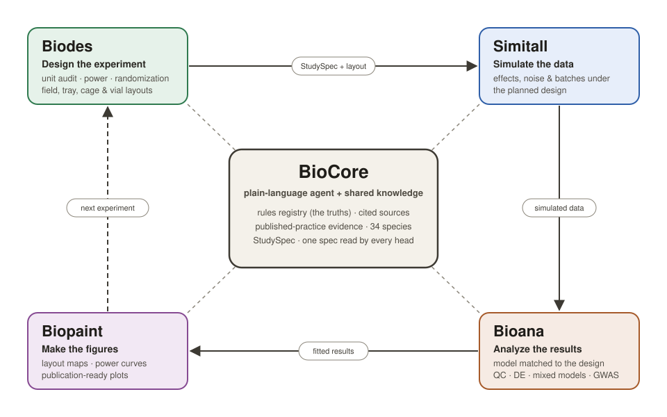
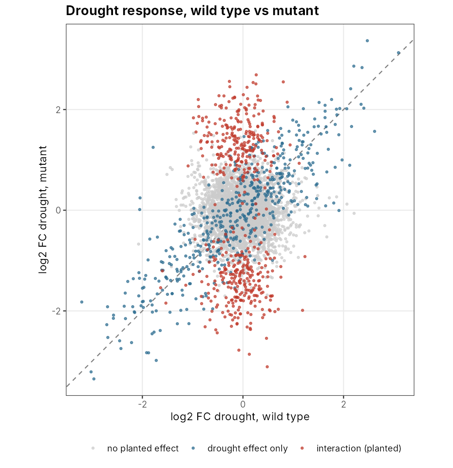
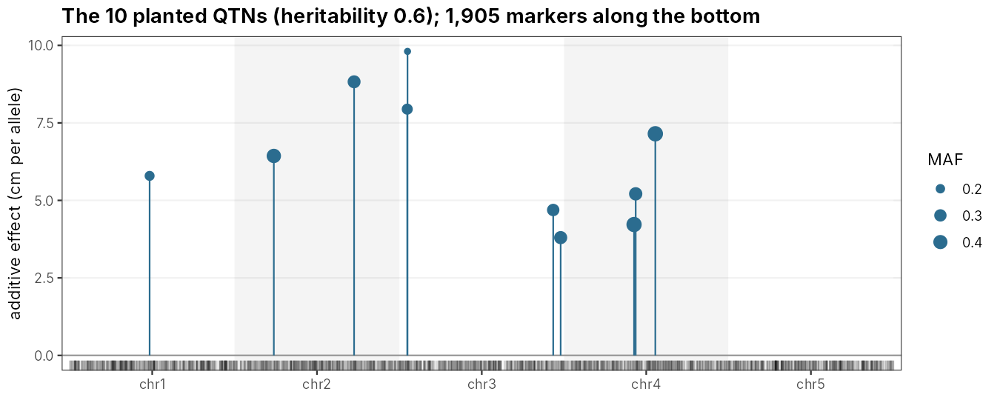
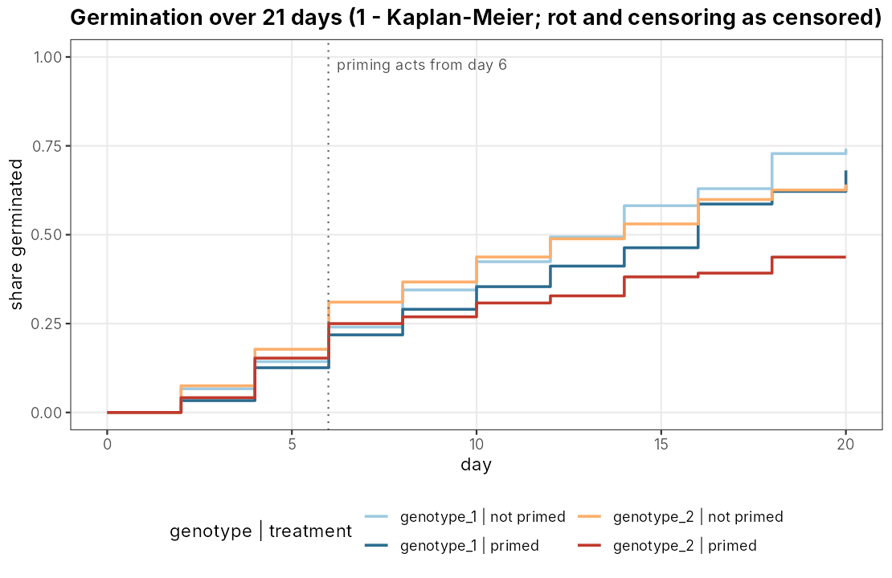

# SimItAll

**Simulate the experiment before you run it, with the answer key.**

**[▶ Try it in your browser](https://nirwan1265.github.io/BioDesignGPT/try/): design an experiment in Biodes, then simulate data with Simitall.** Nothing to install; it runs R in the page.

You describe an experiment in plain words. [Biodes](https://github.com/nirwan1265/BioDesignGPT) turns that
description into a real design: the treatments, the replicates and a randomized field or growth-chamber layout.
**SimItAll** then creates realistic data for every plot, plant or seed in that layout. It plants effects that
you choose, so you know exactly what the right answer is. [Bioana](https://github.com/nirwan1265/Bioana)
analyses the data and is graded against that answer key.

What this tells you before any money is spent:

- Will this design find the effect? SimItAll runs the experiment hundreds of times to check the sample size.
- Does the analysis find what was planted, and how many false hits does it make?
- What will the data files look like, so the pipeline can be built and tested in advance?

<p align="center">
  
</p>

| Step | Tool | What happens |
|---|---|---|
| 1. Question | you | *"Field trial of 24 sorghum hybrids under two nitrogen rates and two irrigation regimes at 3 locations over 2 seasons with 3 replicates; irrigation can only be applied to whole main plots; we want to know whether the nitrogen response differs between hybrids."* |
| 2. Design | [Biodes](https://github.com/nirwan1265/BioDesignGPT) | split plot: irrigation on whole plots, hybrid x nitrogen in subplots, 1,728 plots; model `y ~ water * genotype * nitrogen + block + (1 \| block:water)` |
| 3. Data and answer key | **SimItAll** (this repository) | grain yield for every plot, with a planted hybrid x nitrogen interaction of known size and a whole-plot error |
| 4. Analysis, graded | [Bioana](https://github.com/nirwan1265/Bioana) | the split-plot mixed model; does it find the planted interaction, and how close are the estimates? |
| 5. Figures | Biopaint | in progress |

## See it run in R

### The main example: a sorghum split-plot field trial

The same question as in the [browser demo](https://nirwan1265.github.io/BioDesignGPT/try/). The `#>` lines are the
real R output.

```r
library(studyforge)   # Biodes
library(simitall)
q <- "Field trial of 24 sorghum hybrids under two nitrogen rates (0 and 120 kg N/ha) and two irrigation regimes (full and deficit) at 3 locations over 2 seasons with 3 replicates; irrigation can only be applied to whole main plots; we measure grain yield and want to know whether the nitrogen response differs between hybrids."
a <- studyforge_ask(q)                                                       # Biodes reads the question
write_design_package(layout_from_spec(a$spec, seed = 2026), a$spec, "sorghum_trial")   # design + randomized layout
simitall_from_biodes("sorghum_trial", seed = 2026)                          # SimItAll: data + answer key
#> simitall: simulated 1728 units (continuous outcome) for design 'split_plot_factorial' (y ~ treatment * treatment2 * treatment3 + block + (1 | block:treatment)).

yield <- read.delim("sorghum_trial/sample_metadata_template.tsv")           # grain yield per plot
head(yield[, c("location", "season", "block", "plot", "water", "genotype", "nitrogen", "primary_outcome")], 5)
#>     location   season block plot water    genotype    nitrogen primary_outcome
#> 1 location_1 season_1     1  101  full  genotype_2   0 kg N/ha        124.5469
#> 2 location_1 season_1     1  101  full genotype_19 120 kg N/ha        127.6459
#> 3 location_1 season_1     1  101  full genotype_19   0 kg N/ha        100.1582
#> 4 location_1 season_1     1  101  full  genotype_1   0 kg N/ha        100.5543
#> 5 location_1 season_1     1  101  full genotype_24   0 kg N/ha        117.9764

truth <- jsonlite::read_json("sorghum_trial/sim_truth.json")                # the answer key
truth$goal_truth$goal                                                       # what the question asks
#> [1] "interaction"
unlist(truth$goal_truth$columns)
#> treatment3 treatment2
#> "nitrogen" "genotype"
dod <- do.call(rbind, lapply(truth$goal_truth$difference_of_differences, as.data.frame))
dod[c(1, 2, 12, 23), ]       # how much more each hybrid gains from 120 kg N than hybrid 1 does
#>        level_a     level_b      value
#> 1  120 kg N/ha  genotype_2  0.4347826
#> 2  120 kg N/ha  genotype_3  0.8695652
#> 12 120 kg N/ha genotype_13  5.2173913
#> 23 120 kg N/ha genotype_24 10.0000000
unlist(truth$treatment_effects$treatment3)    # the nitrogen effect for hybrid 1
#>   0 kg N/ha 120 kg N/ha
#>           0          10
unlist(truth$random_sd)                       # whole-plot error: irrigation plots within blocks
#> block:treatment
#>               5
```

Biodes saw that irrigation can only go on whole plots and made it a split plot, with its own whole-plot error.
SimItAll planted exactly that structure: a whole-plot random effect (SD 5), and a nitrogen response that grows
steadily across the 24 hybrids. An analysis that ignores the whole plots, or misses the interaction, will be
caught when it is scored against `sim_truth.json`.

### Three more examples

Each starts from a question typed into Biodes. The code below is exactly what produced the files in
[`examples/showcase/`](examples/showcase), and the `#>` lines are the real R output.

#### 1. RNA-seq: which genes respond to drought differently in the mutant?

```r
library(simitall)
dir <- "examples/showcase/02_rnaseq_drought"      # the folder Biodes wrote: design, layout, sample sheet
simitall_from_biodes(dir, seed = 2026, params = list(simulate_rnaseq_experiment = list(n_genes = 5000)))
#> simitall: simulated 16 units (continuous outcome), assays: rnaseq for design 'factorial' (y ~ treatment * treatment2 + block).

counts <- read.delim(file.path(dir, "counts.tsv"))          # the data: reads per gene per plant
counts[1:3, 1:5]
#>      gene_id SF_factorial_0001 SF_factorial_0002 SF_factorial_0003 SF_factorial_0004
#> 1 gene_00001              1543              2347              2675               862
#> 2 gene_00002               455               374               425               316
#> 3 gene_00003              1004               692               952               373

goal <- read.delim(file.path(dir, "truth/rnaseq_goal.tsv")) # the answer key
nrow(goal)                                                  # genes planted with a mutant-specific drought response
#> [1] 500
head(goal[, c("feature_id", "effect")], 3)                  # effect = difference of differences, log2
#>   feature_id    effect
#> 1 gene_04140  2.026252
#> 2 gene_01685 -1.222648
#> 3 gene_04684 -1.638699
```

<p align="center"></p>

Each point is a gene: its drought response in wild type (x) and in the mutant (y). Genes on the dashed line
respond the same way in both. The 500 planted genes (red) do not, and those are the genes Bioana has to find.

#### 2. GWAS: which markers control plant height in 300 sorghum lines?

```r
dir <- "examples/showcase/01_gwas_sorghum"                  # alpha lattice, 600 plots, 2 replicates
simitall_from_biodes(dir, seed = 2026, params = list(suite_genetics = list(heritability = 0.6)))
#> simitall: simulated 600 units (continuous outcome), 300 lines x 1905 markers (diversity_panel) for design 'alpha' (y ~ treatment + rep + (1 | rep:block)).

pheno <- read.delim(file.path(dir, "sample_metadata_template.tsv"))   # plant height per plot
head(pheno[, c("plot", "rep", "block", "genotype", "primary_outcome")], 4)
#>   plot rep block     genotype primary_outcome
#> 1  101   1     1 genotype_258        134.3664
#> 2  102   1     1 genotype_254        136.7569
#> 3  103   1     1  genotype_48        119.0678
#> 4  104   1     1  genotype_93        104.9421

qtn <- read.delim(file.path(dir, "genetic_truth/qtn_truth.tsv"))      # the answer key: 10 causal markers
head(qtn[order(-abs(qtn$effect)), c("marker_id", "effect", "maf")], 4)
#>     marker_id   effect       maf
#> 1  chr3_48370 9.806724 0.1766667
#> 2 chr2_724691 8.826052 0.3300000
#> 3  chr3_46778 7.943447 0.2466667
#> 4 chr4_552758 7.149102 0.4833333
```

<p align="center"></p>

The genotypes (`genotypes.vcf.gz`) have population structure like a real diversity panel. The 10 planted QTNs
explain 60% of the variation in plant height, and each has a known effect in cm per allele.

#### 3. Survival: does seed priming change time to germination?

```r
dir <- "examples/showcase/03_germination_survival"          # 2 lines x primed/not, 12 trays, 10 seeds per cell
simitall_from_biodes(dir, seed = 2026, interaction_effect = 0)
#> simitall: simulated 48 units x 10 subsamples (survival outcome) for design 'factorial' (y ~ treatment * treatment2 + (1 | block)).

seeds <- read.delim(file.path(dir, "sample_metadata_template.tsv"))   # one row per seed
head(seeds[, c("plot", "genotype", "treatment", "subsample", "primary_outcome", "event")], 4)
#>   plot   genotype  treatment subsample primary_outcome event
#> 1  101 genotype_1 not primed         1              18     1
#> 2  101 genotype_1 not primed         2              14     1
#> 3  101 genotype_1 not primed         3              18     1
#> 4  101 genotype_1 not primed         4               6     1
table(event = seeds$event)            # 1 = germinated, 2 = rotted first, 0 = not yet by day 21
#> event
#>   0   1   2
#> 106 260 114

truth <- jsonlite::read_json(file.path(dir, "sim_truth.json"))      # the answer key
truth$outcome_model$hazard_ratio      # priming effect (hazard ratio), as stated in the question
#> [1] 0.6
round(truth$outcome_model$change_time, 1)   # ...which starts on day 6 (a delayed effect)
#> [1] 6
```

<p align="center"></p>

Each seed has its own germination day, scored every 2 days up to day 21. Seed rot competes with germination,
and trays and tray cells share random effects. The priming effect only starts after day 6.

**Every folder has a README** that lists the question, what was planted, the assumptions made and the files:
[01 GWAS](examples/showcase/01_gwas_sorghum) | [02 RNA-seq](examples/showcase/02_rnaseq_drought) |
[03 survival](examples/showcase/03_germination_survival). The same folder names continue in
[Biodes](https://github.com/nirwan1265/BioDesignGPT/tree/main/examples/showcase) (the design) and
[Bioana](https://github.com/nirwan1265/Bioana/tree/main/examples/showcase) (the analysis, scored against the answer key).

## What SimItAll can simulate

| Data | Examples |
|---|---|
| Field and greenhouse traits | continuous, counts, yes/no, scores, classes, segregation ratios, time-to-event with censoring and competing events, repeated measures |
| Genetics | diversity panels, crosses (RILs, backcrosses), QTNs with additive, dominance, epistatic and genotype x environment effects, VCF genotypes |
| Omics | bulk and single-cell RNA-seq, small RNA, eQTL, ChIP-seq, ATAC-seq, DNA methylation, m6A, microbiome amplicons |
| Designs | anything Biodes writes: CRD, RCBD, alpha lattice, split plots, factorials, repeated measures, covariates (regression, ANCOVA) |

Every run writes `sim_truth.json` (all planted effects and the assumptions made, in plain words) and
`data_manifest.json` (which file holds which data, read by Bioana).

## Check a sample size by simulation

```r
dir <- "examples/showcase/02_rnaseq_drought"
simitall_power_check(dir, n_sim = 100)            # share of simulated experiments where Bioana finds the goal
simitall_power_sweep(dir, reps = c(3, 4, 6, 8))   # the same across replicate numbers
```

## Install

```r
# install.packages("remotes")
remotes::install_github("nirwan1265/simitall")
remotes::install_github("nirwan1265/BioDesignGPT")   # Biodes, to write designs
remotes::install_github("nirwan1265/Bioana")         # to analyse and score
```

To rebuild the three examples: `Rscript examples/showcase/make_showcase.R` from the repository root.

## More

- **[Detailed README](docs/README_DETAILED.md):** full install profiles, every simulator, the R API, validation
  and benchmarks, future work.
- [How SimItAll reads a Biodes design](docs/BIODES_BRIDGE.md) | [Coverage over 4,695 published study designs](docs/SIMULATION_COVERAGE.md) | [Tutorial](docs/TUTORIAL.md)

SimItAll is part of the Biodes suite by Nirwan Tandukar (NC State University). MIT licence.
