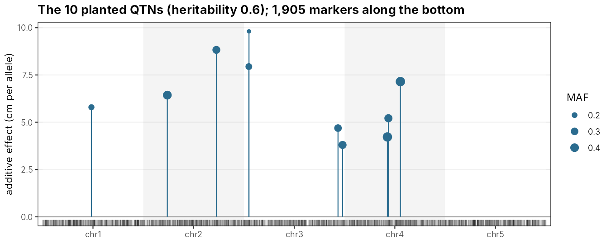

# GWAS of plant height in a sorghum panel: simulated data

**The question (typed into Biodes):**

> GWAS of plant height in 300 sorghum accessions grown in an alpha lattice with 2 replicates at one location in one season.

Biodes turned it into an `alpha` design with the model `y ~ treatment + rep + (1 | rep:block)` ([Biodes folder](https://github.com/nirwan1265/BioDesignGPT/tree/main/examples/showcase/01_gwas_sorghum)). Simitall simulated data for that exact layout, with seed 2026 and heritability 0.6 (`suite_genetics`), and recorded everything it planted in [`sim_truth.json`](sim_truth.json).

## What was planted

- **Genotypes:** 300 inbred accessions x 1,905 markers from a diversity panel with 4 subpopulations (F_ST 0.1), in `genotypes.vcf.gz`.
- **Genetic architecture:** 10 additive QTNs, effects from a geometric distribution; heritability 0.6 (genetic variance 338 cm² against a plot residual SD of 15 cm). Largest: chr3_48370 (+9.8 cm, MAF 0.18), chr2_724691 (+8.8 cm, MAF 0.33), chr3_46778 (+7.9 cm, MAF 0.25).
- **Plots:** plant height = 100 cm + the accession's genetic value + replicate and incomplete-block effects (block SD 7.5 cm) + residual (SD 15 cm), 600 plots.
- **Truth files:** `genetic_truth/qtn_truth.tsv` (marker, position, effect, MAF), `genetic_truth/genetic_values.tsv` (each accession's true value), `genetic_truth/population_structure.tsv`.

## Summary figure

The planted QTNs: genome position, additive effect per allele and minor allele frequency; the ticks at the bottom are the markers in `genotypes.vcf.gz`.

## Files

- From Biodes: [`study_spec.json`](study_spec.json), [`field_layout.csv`](field_layout.csv), [`sample_metadata_template.tsv`](sample_metadata_template.tsv)
- From Simitall: [`data_manifest.json`](data_manifest.json), [`genetic_truth/genetic_values.tsv`](genetic_truth/genetic_values.tsv), [`genetic_truth/population_structure.tsv`](genetic_truth/population_structure.tsv), [`genetic_truth/qtn_truth.tsv`](genetic_truth/qtn_truth.tsv), [`genotypes.vcf.gz`](genotypes.vcf.gz), [`sim_truth.json`](sim_truth.json)
- [`data_manifest.json`](data_manifest.json) tells Bioana which file holds which data and where its truth is.

Assumptions Simitall made where the spec was silent (also in `sim_truth.json`):

- treatment effect = 15 (default: when power.minimum_detectable_difference is missing, the largest treatment difference = this many residual SDs)
- intercept = 100 (default: baseline mean of the primary outcome when the spec gives none)
- attrition = 0 (default: fraction of units lost; from power.attrition when given)
- goal effect size for association = 15 (analysis.goal_effect.association.size not stated: the treatment effect)
- phenotype model = additive (default: simulator_parameters.tsv)

## Continue this example

- **Before:** Biodes wrote the design: [BioDesignGPT/examples/showcase/01_gwas_sorghum](https://github.com/nirwan1265/BioDesignGPT/tree/main/examples/showcase/01_gwas_sorghum)
- **Next:** Bioana analyses these files with the model above and scores the result against the planted truth: [Bioana/examples/showcase/01_gwas_sorghum](https://github.com/nirwan1265/Bioana/tree/main/examples/showcase/01_gwas_sorghum)
- **Then:** Biopaint draws the figures: Biopaint/examples/showcase/01_gwas_sorghum (in progress)

Rebuild: `Rscript examples/showcase/make_showcase.R` from the repository root (simitall 0.1.0).
