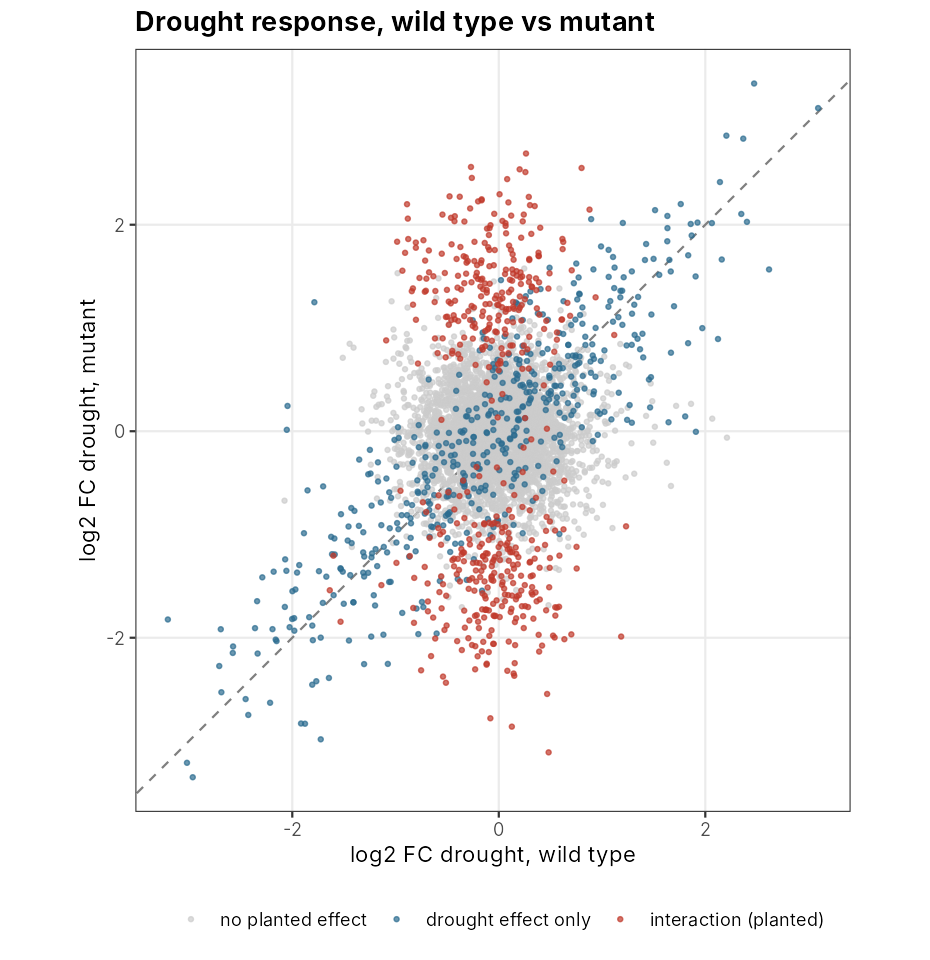

# RNA-seq: genotype x drought in Arabidopsis: simulated data

**The question (typed into Biodes):**

> RNA-seq of leaves from wild type and mutant Arabidopsis under drought and well-watered conditions, 4 plants per genotype per treatment; we want genes whose drought response differs between genotypes.

Biodes turned it into a `factorial` design with the model `y ~ treatment * treatment2 + block` ([Biodes folder](https://github.com/nirwan1265/BioDesignGPT/tree/main/examples/showcase/02_rnaseq_drought)). Simitall simulated data for that exact layout, with seed 2026 and 5,000 genes (`simulate_rnaseq_experiment`), and recorded everything it planted in [`sim_truth.json`](sim_truth.json).

## What was planted

- **Counts:** 5,000 genes x 16 samples (4 plants per genotype x water cell), library size about 5 M reads, negative binomial counts (`counts.tsv`).
- **Drought effect:** 500 genes (10%) change between well-watered and drought in both genotypes, log2 fold changes with SD 1 (`truth/rnaseq.tsv`).
- **The goal, genotype x drought interaction:** 500 genes (10%) whose drought response differs in the mutant. Each has a difference of differences (drought minus well-watered in the mutant, minus the same in wild type) of 1.0 to 2.5 log2 units, either sign (`truth/rnaseq_goal.tsv`: `feature_id, term, effect`).
- **Blocks:** a block effect per replicate (SD 0.15 on the log scale); no hidden factors (`n_latent = 0`).
- Every other gene has no planted effect: these give the false-positive rate.

## Summary figure

Each point is a gene: its observed log2 fold change under drought in each genotype. On the dashed line, drought acts the same in both genotypes; the planted interaction genes (red) sit off it.

## Files

- From Biodes: [`study_spec.json`](study_spec.json), [`field_layout.csv`](field_layout.csv), [`sample_metadata_template.tsv`](sample_metadata_template.tsv)
- From Simitall: [`counts.tsv`](counts.tsv), [`data_manifest.json`](data_manifest.json), [`sim_truth.json`](sim_truth.json), [`truth/rnaseq.tsv`](truth/rnaseq.tsv), [`truth/rnaseq_goal.tsv`](truth/rnaseq_goal.tsv)
- [`data_manifest.json`](data_manifest.json) tells Bioana which file holds which data and where its truth is.

Assumptions Simitall made where the spec was silent (also in `sim_truth.json`):

- residual SD = 10 (default: used when power.residual_sd is missing (10% of the default intercept))
- treatment effect = 10 (default: when power.minimum_detectable_difference is missing, the largest treatment difference = this many residual SDs)
- intercept = 100 (default: baseline mean of the primary outcome when the spec gives none)
- attrition = 0 (default: fraction of units lost; from power.attrition when given)

## Continue this example

- **Before:** Biodes wrote the design: [BioDesignGPT/examples/showcase/02_rnaseq_drought](https://github.com/nirwan1265/BioDesignGPT/tree/main/examples/showcase/02_rnaseq_drought)
- **Next:** Bioana analyses these files with the model above and scores the result against the planted truth: [Bioana/examples/showcase/02_rnaseq_drought](https://github.com/nirwan1265/Bioana/tree/main/examples/showcase/02_rnaseq_drought)
- **Then:** Biopaint draws the figures: Biopaint/examples/showcase/02_rnaseq_drought (in progress)

Rebuild: `Rscript examples/showcase/make_showcase.R` from the repository root (simitall 0.1.0).
