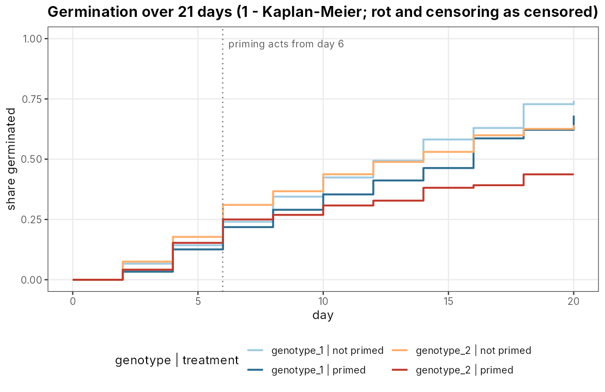

# Seed priming and time to germination: simulated data

**The question (typed into Biodes):**

> Seeds of 2 sorghum lines primed or not in 12 trays in a growth chamber, 10 seeds per treatment per tray, days to germination checked every 2 days, followed for 21 days; seed rot can occur before germination; the priming effect is delayed; hazard ratio 0.6; germination by day 7 and 14.

Biodes turned it into a `factorial` design with the model `y ~ treatment * treatment2 + (1 | block)` ([Biodes folder](https://github.com/nirwan1265/BioDesignGPT/tree/main/examples/showcase/03_germination_survival)). Simitall simulated data for that exact layout, with seed 2026 and default settings except no genotype x priming interaction (see Choices below), and recorded everything it planted in [`sim_truth.json`](sim_truth.json).

## What was planted

- **Seeds:** 480 seeds = 48 tray x genotype x priming cells x 10 seeds; each seed has its own time, scored every 2 days up to day 21.
- **Model:** Weibull hazard (shape 1.5) with a delayed effect: hazard ratio 1 until day 6.0, then 0.6 for primed vs not primed seeds (the HR stated in the question, and in the spec as `power.target_hazard_ratio`; below 1, so primed seeds germinate more slowly once the effect starts; the delay is `logrank_weight: fh_0_1`). The second line gets the same hazard ratio against the first; no genotype x priming interaction.
- **Germination speed:** the reference group (genotype 1, not primed) has a median of 12.0 days (set so 20% of it has not germinated by day 21).
- **Seed rot (competing event, code 2):** its own hazard with no treatment effect, median 24 days if nothing else happened. Outcome: 260 germinated, 114 rotted (24% of seeds), 106 still waiting at day 21 (censored).
- **Clusters:** trays share a log-normal frailty (SD 0.26 on the log hazard), and so do the 10 seeds of one tray cell (SD 0.30).

True values per group (conditional on an average tray), from `sim_truth.json` `outcome_model.groups`:

| genotype | treatment | median, germination alone (days) | germinated by day 14 (CIF) | not germinated or rotted by day 14 | RMST to day 21 (days) |
|---|---|---|---|---|---|
| genotype_1 | not primed | 12.0 | 0.51 | 0.31 | 10.6 |
| genotype_1 | primed | 15.2 | 0.41 | 0.39 | 11.7 |
| genotype_2 | not primed | 15.2 | 0.41 | 0.39 | 11.7 |
| genotype_2 | primed | 19.9 | 0.34 | 0.46 | 12.5 |

### Choices made for this example, and how to change them

- **No interaction.** The Biodes model is `treatment * treatment2`, so by default Simitall would plant a genotype x priming interaction the question never asked about. It is turned off here (`interaction_effect = 0`) so the story stays "a delayed priming effect". Option: `SHOWCASE_INTERACTION=model Rscript examples/showcase/make_showcase.R` plants it at the default size (`interaction_effect` in `simitall_from_biodes()`).
- **HR 0.6 slows germination.** A hazard ratio below 1 means primed seeds germinate *more slowly* once the effect starts; above 1, faster. 0.6 is what the question typed, so that is what is planted. If priming should speed germination, the question should say HR 1.67, or run `SHOWCASE_PRIMING_HR=1.67 Rscript examples/showcase/make_showcase.R` (`params = list(suite_outcome = list(hazard_ratio = 1.67))`, which overrides the spec).
- **Survival fixes found while building this.** The survival goal's note in `sim_truth.json` still described the old log-normal model, and a stated hazard ratio raised a misleading "no data on this scale" note. Both were fixed in Simitall before these files were written.

## Summary figure

Observed germination curves per genotype and priming; the dotted line is where the planted priming effect starts.
A quick look drawn by `make_showcase.R`; the full figure set for each example belongs to Biopaint.

## Files

- From Biodes: [`study_spec.json`](study_spec.json), [`field_layout.csv`](field_layout.csv), [`sample_metadata_template.tsv`](sample_metadata_template.tsv)
- From Simitall: [`data_manifest.json`](data_manifest.json), [`sim_truth.json`](sim_truth.json)
- [`data_manifest.json`](data_manifest.json) tells Bioana which file holds which data and where its truth is.

Assumptions Simitall made where the spec was silent (also in `sim_truth.json`):

- the residual SD in days was not stated: the outcome is standardized (residual SD 1, mean 0) and every effect is in residual SDs; the treatment effect is 1 SD. Power depends on the real SD.
- attrition = 0 (default: fraction of units lost; from power.attrition when given)
- survival model delayed_effect: analysis.survival.logrank_weight fh_0_1 (a stated delayed effect)
- survival median time 12 (from follow-up 21: 0.2 of the reference group without the event at its end (censored_fraction))

## Continue this example

- **Before:** Biodes wrote the design: [BioDesignGPT/examples/showcase/03_germination_survival](https://github.com/nirwan1265/BioDesignGPT/tree/main/examples/showcase/03_germination_survival)
- **Next:** Bioana analyses these files with the model above and scores the result against the planted truth: [Bioana/examples/showcase/03_germination_survival](https://github.com/nirwan1265/Bioana/tree/main/examples/showcase/03_germination_survival)
- **Then:** Biopaint draws the figures: Biopaint/examples/showcase/03_germination_survival (in progress)

Rebuild: `Rscript examples/showcase/make_showcase.R` from the repository root (simitall 0.1.0).
